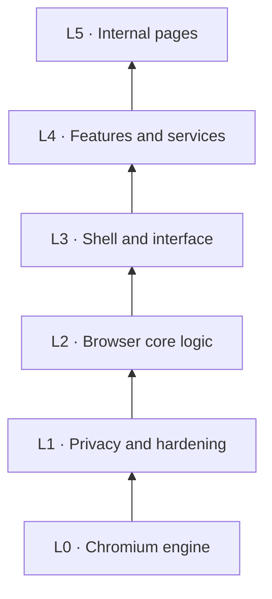

# Proposed architecture

- **Status:** Six-layer product architecture accepted as a planning baseline; Chromium WebUI shell direction is proposed in ADR 0003 and awaits a real integration spike.
- **Targets:** Windows, Linux, macOS.
- **Engine candidate:** Chromium using Helium's patch/tooling foundation with matching platform packaging pins.
- **Shell candidate:** one Nocturne-owned Chromium WebUI shell, not three independent native shells.

## Architectural rule

The product is divided into six layers. Each layer may depend only on the layer below it. Keep Nocturne-specific Chromium patches small, isolated and testable.

## Layer responsibilities

| Layer | Responsibility | Initial source/approach |
|---|---|---|
| L0 — Engine | Pinned Chromium source and repeatable builds | Chromium through a verified Helium patch/tooling + per-platform packaging set |
| L1 — Privacy and hardening | De-Googling, domain substitutions, flags, content blocking, filter lists, opt-in crash reports | Helium first; audit every imported patch/component |
| L2 — Browser core | Spaces/storage model, omnibox parsing/suggestions, tab lifecycle, routing, URL-cleaner rules | Nocturne-owned typed core informed by Crest/Ardia; reimplement or reuse only after audit |
| L3 — Shell and interface | Sidebar, tabs, folders, split views, Peek, command bar, window chrome, theme and motion | Shared Nocturne-owned Chromium WebUI; narrow native adapters |
| L4 — Features and services | Importers, updates, command actions, optional future services | Add in measured increments |
| L5 — Internal pages | Start page, settings, Insights, onboarding | Small web UI using the Nocturne design system |

## Cross-platform shell direction

The first implementation spike should test one shared privileged WebUI page (provisionally `chrome://nocturne/`) across Windows, Linux and macOS. Chromium can host a shared web UI while native adapters handle only platform-specific capabilities such as the window frame, file dialogs, credential storage, notifications, installer and updater integration.

This is a proposed direction, not a completed integration. A privileged WebUI must not become a general-purpose webpage bridge. Validate the committing origin and primary frame, use a typed allow-listed request schema, reject untrusted page-origin calls, and keep credentials/filesystem access out of the UI surface. The standalone `prototype/` is a visual/interaction study and must not automatically be treated as safe privileged UI code.

The current Ardia source audit shows a Chromium-hosted WebUI desktop-shell direction on Linux and an evolving Windows WebUI implementation. Its Windows PR #1116 was merged and its initial alpha ran CI self-checks and tours on Windows 11 VM/GitHub runners, but the PR explicitly had not been tried on real PC hardware. Current main docs also list Windows-specific incomplete calls/features. Use it as evidence and a behavior reference, not as proof of Nocturne cross-platform readiness.

## Space model

A Space is a first-class browsing environment, not merely a tab folder. The intended isolation boundary includes:

- Cookies, origin/site data, cache, history, and permissions.
- Tabs, pinned pages, folders, and a recoverable closed-tab archive.
- Credentials and per-Space settings.
- Content-blocking mode: Off, Balanced, or Strict.
- One of the five Nocturne visual moods.

Map the model to Chromium's actual Profile/BrowserContext and storage primitives. Prove that cookies, local storage, cache, permissions, service workers, downloads, and history do not leak between Spaces before treating isolation as complete. Sub-Spaces that share sign-ins are a later design problem and must not weaken the default isolation boundary.

Private Spaces use temporary storage, do not enter normal history or sync, and must close/clear according to a tested lifecycle. The brief proposes relocking when the application loses focus; validate its usability and threat model before implementation. The prototype's Vigil state is visual only and is not real data isolation.

## Privacy and security rules

- No telemetry by default.
- Crash reporting is opt-in and must not contain URLs or page contents.
- Do not require a Nocturne account for normal browsing.
- Keep Chromium, Helium patches and platform packaging revisions pinned as a compatible set.
- Keep Nocturne-specific Chromium patches separate from upstream patches.
- Maintain an SBOM and provenance ledger for every shipped dependency and borrowed file.
- Make security updates a release-blocking maintenance routine.

## Cross-cutting requirements

- Windows, Linux and macOS builds and smoke tests are release requirements; no platform is considered supported from documentation alone.
- Arabic and right-to-left layout must be designed in from the start; test mirroring, text shaping, focus movement and motion direction.
- Support keyboard navigation, visible focus, meaningful contrast and reduced motion.
- Keep website content untinted and brighter than browser chrome.
- Preserve upstream notices and do not reuse source product names, logos, icons, screenshots or the private moodboard paintings.

## Source-audit record and pending decisions

See [the 2026-11-25 source audit](audits/2026-11-25-source-audit.md), [pinned upstream commits](third-party/upstream-pins.csv) and ADR 0003. Still pending: minimum OS versions, Linux distribution/package matrix, the exact Chromium + Helium + platform-package compatibility pin, native bridge ABI, credential-store adapters, build hardware/CI, filter-list update policy, and whether Sub-Spaces are ever needed.
